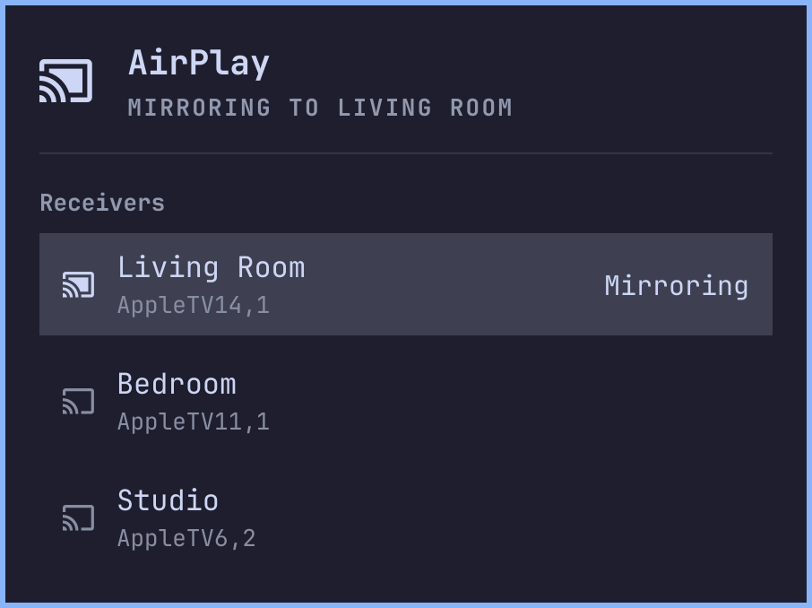

# omarchy-airplay

An [Omarchy](https://omarchy.org/) bar widget that mirrors your desktop to an Apple TV or other AirPlay receiver. Click the cast icon in the bar, pick a receiver, and your screen and sound go to the TV. Pick it again, or right-click the icon, to stop.

It wraps [doubletake](https://github.com/omarroth/doubletake), which does the AirPlay mirroring.



## Requirements

- Omarchy 4.5 or later
- doubletake 0.6 and the GStreamer plugins it needs:

  ```sh
  yay -S doubletake-bin
  sudo pacman -S --needed gst-plugin-va gst-plugins-ugly gst-libav gst-plugin-pipewire
  ```

- Your firewall must let the receiver connect back on the widget's port range (default `60000-60010`, TCP and UDP). With ufw, replace the address with your Apple TV's:

  ```sh
  sudo ufw allow proto tcp from 192.0.2.10 to any port 60000:60010
  sudo ufw allow proto udp from 192.0.2.10 to any port 60000:60010
  ```

## Install

```sh
omarchy plugin add https://github.com/aryan-binazir/omarchy-airplay.git --enable
omarchy bar move aryan-binazir.airplay --section right
```

The widget is part of the Omarchy shell, so it is there after every login.

## Use

- **Left click** opens the receiver list. Click a receiver to mirror to it; click it again to stop. Picking a different receiver moves the mirror there.
- **Right click** stops mirroring.
- The first time you mirror to an Apple TV it shows a 4-digit code; type it into the panel.
- Each time you start mirroring, a screen-share picker asks what to share: a screen, a window or a region.
- While mirroring, sound plays on the TV only. When mirroring stops, sound goes back to the output you had before. If you pick another output while mirroring, that choice is kept.

The doubletake daemon runs only while the panel is open or something is being mirrored, in a user unit named `omarchy-airplay.service`. Once the panel is closed it stops as soon as mirroring ends, and in any case after five minutes without mirroring. If doubletake's own `doubletake.service` is running, the widget leaves it alone and asks you to stop it.

## Settings

`portRange` in the widget's entry in `~/.config/omarchy/shell.json` sets the local ports the receiver connects back to (at least three ports).

## Development

```sh
make test
```

This parses `manifest.json` and `i18n/en.json` with `jq`, then runs the node tests. The tests run the real helper against fake `doubletake`, `pactl` and `systemd` programs, so they never touch a receiver or your sound settings. Last, `Service.qml` runs under Qt 6's `qmltestrunner` (from `qt6-declarative`) against a fake `Quickshell.Io` in `tests/qml`, offscreen, so no window opens.

## License

MIT
